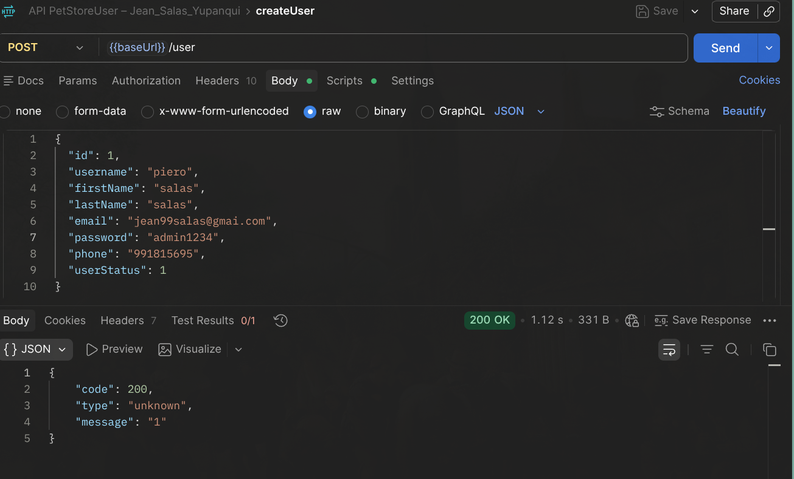
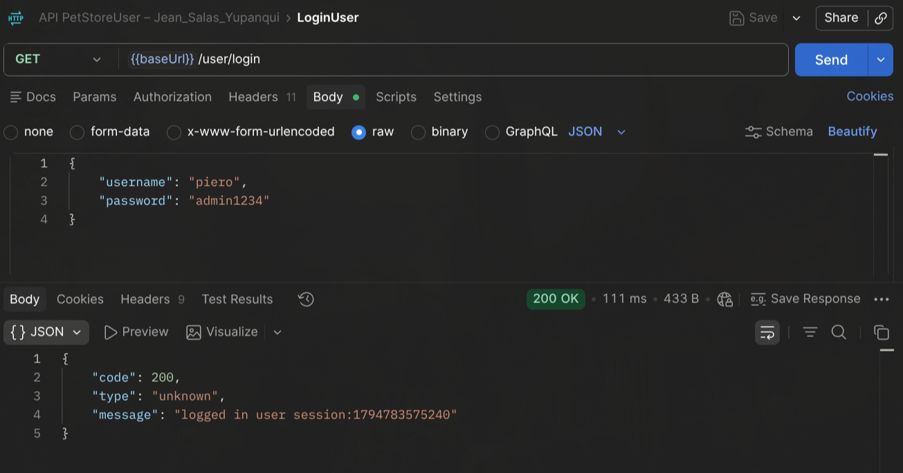
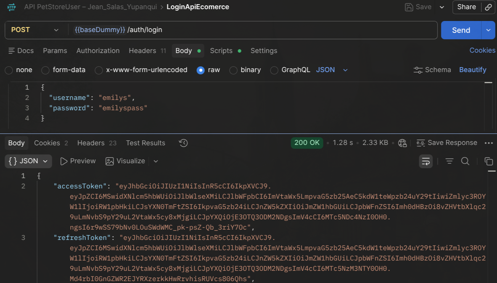
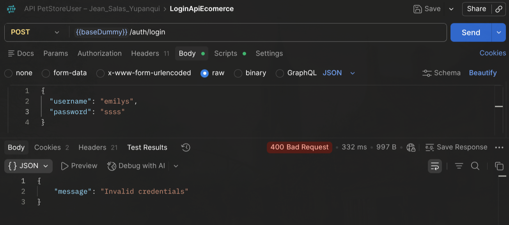
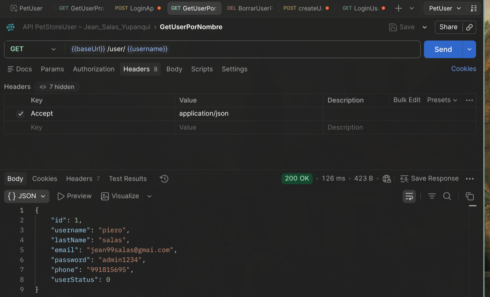
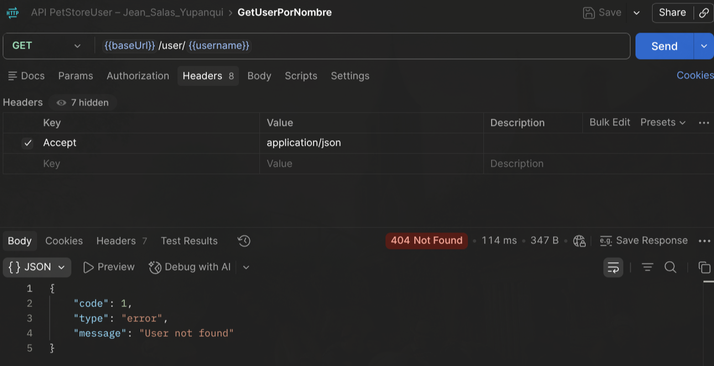
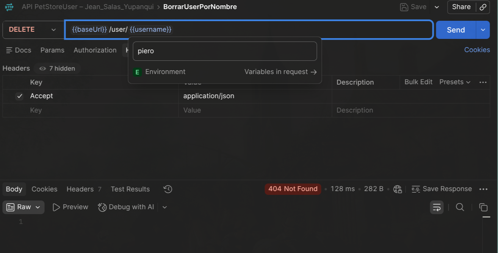
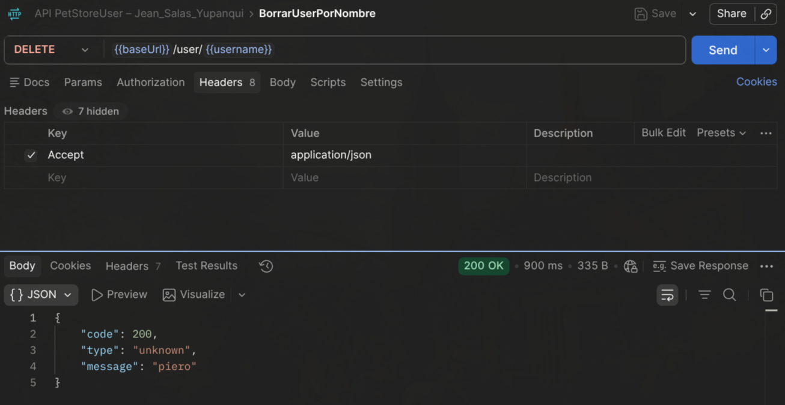
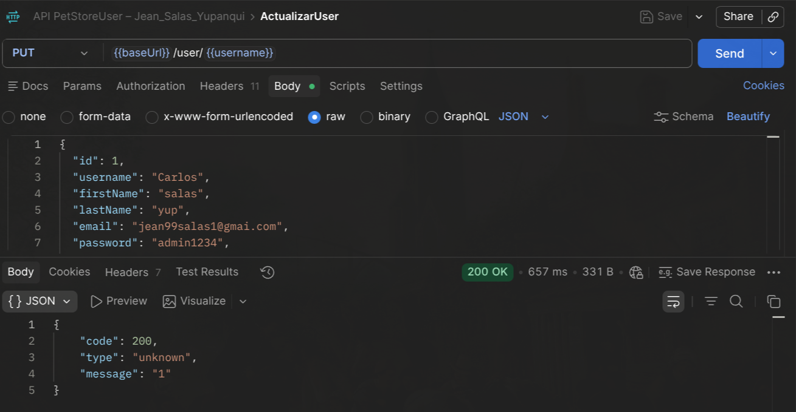

# Suite de Pruebas en Postman / Bruno de APIs (CRUD PetStore & Flujo eCommerce)

Este proyecto contiene la suite de pruebas en Postman y Bruno para evaluar dos servicios RESTful: el **CRUD completo de Usuarios en Swagger Petstore (`petstore.swagger.io/v2`)** y el flujo de **Autenticación con Bearer Token en DummyJSON eCommerce**.

- **Autor:** Jean Salas Yupanqui
- **Herramienta:** Postman (Collection v2.1) / Bruno
- **Tipo de Pruebas:** Funcionales, Validación de Esquemas, Pruebas Positivas y Pruebas Negativas

---

## Estructura del Repositorio

```text
├── images/                                                    # Capturas y evidencias de ejecución
├── API PetStoreUser – Jean_Salas_Yupanqui.postman_collection.json # Colección de pruebas de Postman
└── README.md                                                  # Documentación técnica del proyecto
```

---

## Configuración de Variables de Entorno (Environment)

Para ejecutar esta colección de forma dinámica se requiere un entorno en Postman con las siguientes variables:

| Variable | Tipo | Valor Inicial / Ejemplo | Descripción |
| - | - | - | - |
| `baseUrl` | URL | `https://petstore.swagger.io/v2` | Servidor base de Swagger PetStore |
| `baseDummy` | URL | `https://dummyjson.com` | Servidor base de eCommerce DummyJSON |
| `username` | String | `piero` | Usuario dinámico para rutas del CRUD |
| `password` | String | `admin1234` | Contraseña dinámica para las rutas del CRUD |
| `token` | Secret | *(Generado dinámicamente)* | Token extraído automáticamente en el Login del eCommerce |

---

## Matriz de Endpoints (Mapeo CRUD y Auth)

| Servicio | Método | Endpoint | Acción / Operación | Código Esperado |
| - | - | - | - | - |
| **PetStore** | `POST` | `{{baseUrl}}/user` | **Create:** Crear nuevo usuario | `200 OK` |
| **PetStore** | `GET` | `{{baseUrl}}/user/{{username}}` | **Read:** Consultar usuario por username | `200 OK` / `404` |
| **PetStore** | `PUT` | `{{baseUrl}}/user/{{username}}` | **Update:** Modificar datos del usuario | `200 OK` |
| **PetStore** | `DELETE` | `{{baseUrl}}/user/{{username}}` | **Delete:** Eliminar usuario del sistema | `200 OK` / `404` |
| **PetStore** | `GET` | `{{baseUrl}}/user/login` | **Login:** Iniciar sesión de usuario | `200 OK` |
| **eCommerce** | `POST` | `{{baseDummy}}/auth/login` | **Auth:** Iniciar sesión y generar JWT | `200 OK` |
| **eCommerce** | `GET` | `{{baseDummy}}/auth/me` | **Profile:** Consultar perfil con Bearer Token | `200 OK` / `401` |

---

## Estrategia de Pruebas 

Para garantizar una cobertura integral de aseguramiento de calidad, se diseñaron dos grupos de pruebas:

### 1. Pruebas Positivas (Happy Path - Escenarios Exitosos)

Se valida que las APIs respondan con el formato y los códigos de éxito esperados ante datos correctos:

- **CP-01 (`createUser`):** Registro exitoso del usuario `piero` y verificación de tiempo de respuesta óptimo.
- **CP-02 (`GetUserPorNombre`):** Consulta exitosa del usuario previamente creado mediante la variable `{{username}}`.
- **CP-03 (`ActualizarUser`):** Modificación del usuario a nombre de `Carlos` devolviendo `200 OK`.
- **CP-04 (`LoginApiEcomerce`):** Inicio de sesión con credenciales válidas (`emilys` / `emilyspass`) y extracción automática del token de acceso a la variable `{{token}}`.
- **CP-05 (`GetUserProfileEcomerce`):** Consumo del endpoint protegido `/auth/me` enviando el `Bearer Token`, validando que el perfil retornado pertenezca a `emilys` y contenga `id` y `email` válido.

### 2. Pruebas Negativas (Unhappy Path - Escenarios de Error Controlado)

Como parte de las buenas prácticas de QA, se ejecutan peticiones diseñadas intencionalmente para validar cómo responde la API ante entradas erróneas:

- **CN-01 (`GetUserPorNombre - 404 Not Found`):**
  - **Acción:** Consultar un usuario inexistente (ejemplo: `{{baseUrl}}/user/usuario_que_no_existe_999`).
  - **Resultado Esperado:** Código HTTP `404 Not Found` con mensaje `"User not found"`.

- **CN-02 (`LoginApiEcomerce - 400 Bad Request / Credenciales Inválidas`):**
  - **Acción:** Enviar contraseña errónea (`password: "clave_incorrecta"`).
  - **Resultado Esperado:** Código HTTP `400 Bad Request` indicando credenciales inválidas.

- **CN-03 (`GetUserProfileEcomerce - 401 Unauthorized / Token Inválido`):**
  - **Acción:** Consultar `/auth/me` enviando un token corrupto o vacío en el encabezado `Authorization`.
  - **Resultado Esperado:** Código HTTP `401 Unauthorized` bloqueando el acceso al recurso privado.

- **CN-04 (Fallo de Aserción de Rendimiento):**
  - **Acción:** El test de `createUser` exige un tiempo `< 200ms`. Si la red o el servidor demora 350ms, el test arroja un fallo controlado demostrando que la aserción vigila la degradación de rendimiento.

---

## Evidencias de Pruebas (Test Execution)

### A. Ejecución de Casos Positivos (Happy Path)

#### 1. Creación de Usuario (`POST /user`)


#### 2. Login user/login (`GET /user/login`)


#### 3. Autenticación eCommerce Exitosa (`POST /auth/login`)


#### 4. Autenticación eCommerce con Credenciales Inválidas (`POST /auth/login`)


#### 5. Consulta de Usuario por Nombre (`GET /user/{username}`)


#### 6. Consulta de Usuario con Datos Inválidos (`GET /user/{username}`)


#### 7. Eliminación de Usuario (`DELETE /user/{username}`)



#### 8. Actualización de Datos de Usuario (`PUT /user/{username}`)


> Se muestra la extracción del token y su uso exitoso con Bearer Token, con todos los tests en verde (`PASS`).
